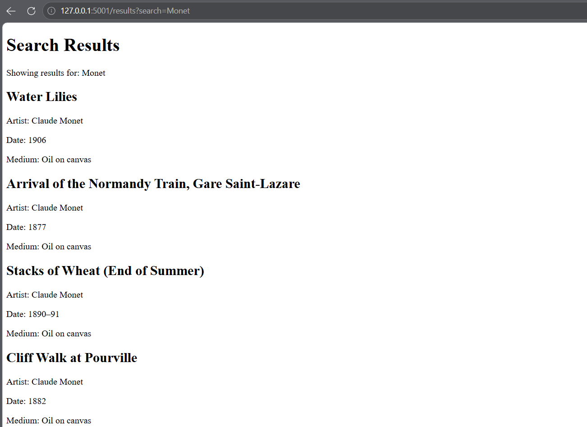

# Art Explorer

## Project Description

Art Explorer is a web application that allows users to search for artwork from the Art Institute of Chicago. Users can search by artist name or artwork title and view information about matching artworks, including the title, artist, date, and medium.

## Intended Audience

This application is intended for people interested in exploring art, learning about artists, and discovering artwork from the Art Institute of Chicago.

## Features

- Search for artwork by artist name or artwork title.
- View artwork titles, artists, dates, and mediums.
- Display a message when no relevant artwork is found.
- Handle API connection errors with a helpful message.
- Provide fallback text when artwork information is unavailable.

## API

This project uses the [Art Institute of Chicago API](https://api.artic.edu/docs/).

The application requests the following artwork fields:
- Title
- Artist
- Date
- Medium

## How to Run

1. Clone or download the project repository.
2. Open a terminal in the main `HCDE-310-` project folder.
3. Activate the virtual environment:

   ```powershell
   .\.venv\Scripts\Activate.ps1
   ```

4. Install the required packages if needed:

   ```powershell
   pip install flask requests
   ```

5. Start the Flask application:

   ```powershell
   flask --app art_explorer.app run --debug
   ```

6. Open http://127.0.0.1:5000 in your browser.

## Screenshot


