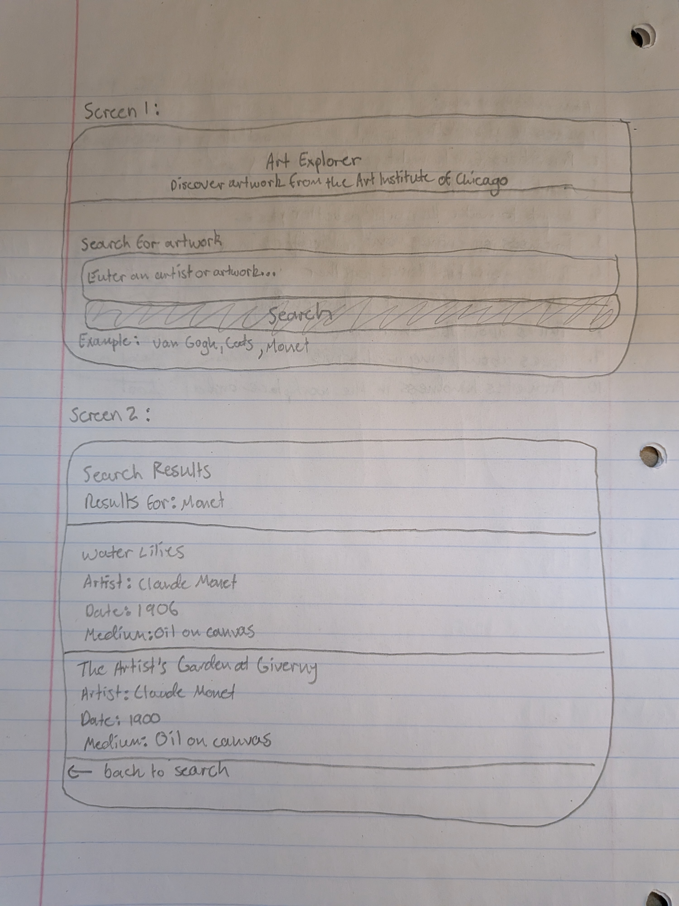

# Art Explorer – Project Plan

Reid Schmidt  
11/1/26  
HCDE 310

## 1. Screen Sketch

**Search Page (home.html)**
- App title: Art Explorer
- Short description explaining the app
- Search input where users enter an artist or artwork
- Search button
- Visible label for the search input

**Results Page (results.html)**
- Heading: Search Results
- Display the search term
- List of matching artworks
- Each artwork displays its title, artist, date, and medium
- Message if no results are found
- Link to return to the search page

## 2. API Data

Using the Art Institute of Chicago API from HW3.

**Fields needed:**
- `title`: Artwork title
- `artist_title`: Artist name
- `date_display`: Artwork date
- `medium_display`: Artwork medium

If a field is missing or empty, display a helpful fallback such as "Unknown artist" or "Unknown date."

The app requests up to 10 artworks per search. It also uses the API's relevance scores to filter out unrelated results. Artwork images will not be included in the initial version.

## 3. Function and Route Specifications

### A. Search Route (/)

**Input:**
- User visits the homepage.

**Output:**
- Displays the search form.

**Checks:**
1. Visit `/` and verify the search form appears.
2. Verify the search input has a visible label.
3. Verify the search button can be reached using the Tab key.

### B. Search Page Template (home.html)

**Input:**
- No required input.

**Output:**
- Displays the app title, description, search input, and submit button.

**Checks:**
1. Verify all page elements appear.
2. Verify the input accepts text.
3. Verify submitting the form sends the search to `/results`.

### C. Artwork Search Function (api.py)

**Input:**
- A search term entered by the user.

**Output:**
- A list of relevant artworks containing title, artist, date, and medium.
- Returns an empty list if no relevant artworks are found.

**Checks:**
1. Search for "Monet" and verify artwork results are returned.
2. Search for a nonsense term and verify unrelated low-relevance results are filtered out.
3. Simulate an API connection error and verify the error is handled without crashing the app.

### D. Results Route (/results)

**Input:**
- Search term submitted through the form.

**Output:**
- Calls the artwork search function and displays matching results on the results page.
- Passes error messages and search information to the results template when necessary.

**Checks:**
1. Search for "Monet" and verify matching artworks appear.
2. Submit an empty search and verify a helpful message appears.
3. Simulate an API error and verify the error message appears on the results page.

### E. Results Page Template (results.html)

**Input:**
- Search term and list of artworks passed from the results route.

**Output:**
- Displays the search term and artwork information.
- Displays appropriate messages for empty searches, API errors, and searches with no results.

**Checks:**
1. Verify each artwork displays its title, artist, date, and medium.
2. Verify missing artwork fields display fallback text.
3. Verify the page displays a helpful message when there are no results.

## 4. Error and Empty

- **Empty input:** Ask the user to enter a search term.
- **No results:** Explain that no matching artworks were found.
- **API error:** Display a message explaining that the artwork search is temporarily unavailable.
- **Missing field:** Display fallback text such as "Unknown artist" or "Unknown date."
- **Irrelevant results:** Filter out artworks with relevance scores below the selected threshold.

## 5. Accessibility

- Use a visible label for the search input.
- Use descriptive page headings.
- Ensure the search form works using a keyboard.
- Use readable text and sufficient contrast.
- Group artwork information using semantic HTML elements.
- Use an alert role for API error messages.

## 6. Test Results (Final checks)

The following checks were performed in the browser to verify that Art Explorer works as expected.

| Test | Expected Result | Actual Result |
|---|---|---|
| Search "Monet" | Matching artworks appear. | PASS |
| Search "Van Gogh" | Matching artworks appear. | PASS |
| Submit an empty search | A helpful message asks the user to enter a search term. | PASS |
| Search a random nonsense term | A no-results message appears. | PASS |
| Simulate an API error | An API error message appears without crashing the app. | PASS |
| Missing artwork fields | Fallback text appears when artwork information is missing. | PASS |
| Keyboard navigation | The search input and button can be reached using Tab. | PASS |