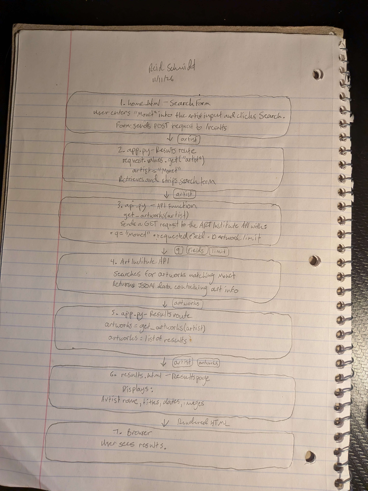

# HW5 findings

## 1. Drawing: one search for "Monet"

## 2. Two questions about the code
1. What does request.values.get("artist") do? How is it different from request.form.get("artist")?
2. Why does the @app.route("/results", methods=["GET", "POST]) allow both GET and POST requests when the search form only uses POST?

## 3. Checks (4 or more, at least 2 as pytest tests)
| # | Check | Pass or fail |
|---|---|---|
| 1 | Visit homepage and verify search form appears. | pytest(starter) | PASS
| 2 | Search for Monet and verify artwork results appear. | pytest | PASS
| 3 | Search with missing image ID and verify fallback message. | pytest | PASS
| 4 | Search for a nonsense artist name and verify no-results message. | manual | FAIL
| 5 | Use Tab to navigate through the search form | Manual | PASS

## 4. AI review
What it found that I missed: In api.py, the FIELDS variable does not request the API's _score field. In api.py, the function returns the first 10 results without checking whether they are relevant. In app.py, the app displays the raw exception message to the user. In app.py, debug mode is enabled. In home.html, the artist input has a visible label, however it does not have the required attribute, so the browser does not prevent an empty submission. In results.html, Images use the artwork title as their art text, but a missing artwork title could result in poor alt text. Also in results.html, the page has headings and a link back to search which is relatively straightforward. 

What it got wrong: The GET and POST route support is not necassarily a bug. The form currently submits using POST, but allowing GET requests could make the results page accessible through a URL containing a search term. It may be unnecessary, but it is not inherently incorrect. 

Answers to my two questions, in my own words:

1. request.values.get("artist") looks for the artist value in both the URL query parameters and submitted form data. request.form.get("artist") only looks at data submitted through a form. So either could retrieve the artist name in the current setup.

2. The route decorator allows both methods. POST is what our form currently uses, but GET would also allow someone to visit a results URL with a search term in the URL. Supporting both gives some flexibility.

## 5. My fix
What was wrong: The app displayed unrelated artwork because it didn't filter API results by relevance.
What I changed: Added _score to the API fields and filtered out artworks with scores at or below 0.001.
How I checked it works: I ran all four pytests and they passed. I also searched Monet and a nonsense artist name in the browser - Monet returned relevant artwork info and nonsense search returned no results. 
Commit before: (dbe8fdb)  Commit after: (6200d94)

## 6. Can we ship it? (100–150 words)
Yes or no, and why:

Yes I think we can as a basic classroom project, but it needs improvements before being released publicly. The app successfully searches the Art Institute of Chicago collection, displays artwork information, and filters irrelevant results using the API's relevance score. However, its error handling could be improved and it currently displays technical error messages that could confuse users. I think before release, we could make it look nicer, and make the error messages more user friendly.

One thing my HW4 does better: HW4 has more specific error handling, and catches request related errors and displays a friendlier message instead of catching every type of exception and potentially showing technical error details to the user. 

One thing the AI's app does better: HW5 allows users to submit searches using either GET or POST requests, making the results route more flexible. The search form uses POST, but the route also accepts GET requests. 

AI use goes in `ai_use.md` (the five points on the AI Use Card).
